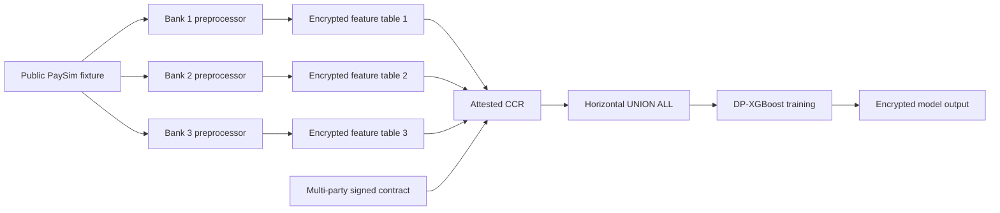

# Mule Account Detection Consortium

This scenario demonstrates how three financial institutions can train a shared
binary classifier for mule-account risk using DEPA Training. Each institution
derives an account-level behavioural feature table locally. The three encrypted
tables are combined with a horizontal `UNION ALL` inside the Confidential Clean
Room (CCR), where a differentially private XGBoost model is trained.

The scenario is inspired by a first-phase dormant-account-activation pattern:
an account is inactive, receives a burst of transfers from multiple sources,
and then moves funds out rapidly. It is an architecture and integration example,
not a production fraud model.

## Scenario type

| Scenario name | Scenario type | Task type | Privacy | TDPs | Data format | Model format | Join |
|---|---|---|---|---:|---|---|---|
| Mule Account Detection | Training - Classical ML | Binary classification | Differentially private | 3 | Derived tabular data (Parquet) | XGBoost (JSON) | Horizontal (3 datasets) |

The participants are:

- `bank_1`, `bank_2`, and `bank_3`: Training Data Providers (TDPs).
- A deployment-selected lead bank or consortium operator: Training Data
  Consumer (TDC).
- A CCR Provider (CCRP): operates the attested confidential environment.
- A consortium-approved contract service: records the multi-party signed
  training contract.

Account Aggregator is not part of this training flow. Each participating bank
would deploy the trained model within its own systems and decide how to review
or act on scores under its existing authority. Live scoring and case-management
integration are outside this repository scenario.

## What the sample implements

The local sample uses the public PaySim transaction simulator dataset. PaySim
does not contain real account-opening dates, a six-month observation period, or
confirmed bank investigation outcomes. The preprocessor therefore uses the
following proof-of-concept proxies.

| Intended signal | Output column | PaySim derivation |
|---|---|---|
| Account age | `account_age_days` | Days between the account's first observed event and the end of the PaySim log |
| 24-hour velocity | `vel_24` | Maximum rolling 24-hour inbound-plus-outbound value |
| 48-hour velocity | `vel_48` | Maximum rolling 48-hour inbound-plus-outbound value |
| 72-hour velocity | `vel_72` | Maximum rolling 72-hour inbound-plus-outbound value |
| Counterparty fan-in | `fan_in` | Distinct inbound counterparties over the observation period |
| Counterparty fan-out | `fan_out` | Distinct outbound counterparties over the observation period |
| Dormancy transition proxy | `dormancy_ratio` | Longest inactive gap divided by the account's active span |
| Mule label proxy | `is_mule` | Destination of a fraudulent transfer or origin of a fraudulent cash-out event |

For a production adapter, banks should replace these proxies with features from
their own account-opening, transaction-monitoring, AML, and confirmed-case
systems. In particular, production features should be calculated at an explicit
observation cutoff and labels should come from confirmed historical cases.

## Data boundaries

The sample emulates three providers by deterministically assigning PaySim
customer accounts to banks. Each local preprocessor sees the public PaySim log,
but writes only the rows assigned to its bank. This fixture construction should
not be interpreted as cross-bank access to production ledgers.

| Boundary | Data |
|---|---|
| Bank-local input | PaySim transaction rows in the sample; a bank's own transaction history in production |
| Bank-local processing | Account grouping, rolling windows, counterparty counts, proxy label derivation |
| Provider output | Seven numerical features and the binary `is_mule` proxy label |
| Removed before provider output | PaySim `account_id`, raw transactions, counterparty identifiers |
| CCR input | Three encrypted Parquet feature tables |
| CCR output | Trained model and evaluation artifacts in the encrypted output filesystem |

The provider schema is:

```text
account_age_days, vel_24, vel_48, vel_72,
fan_in, fan_out, dormancy_ratio, is_mule
```

## Training flow



The checked-in pipeline uses:

- `SparkJoin` to combine the three identically shaped datasets.
- `Train_XGB` with `objective: binary:logistic`.
- Min-max feature scaling.
- Stratified 80/10/10 train, validation, and test splits.
- Privacy parameters ε = 5.0 and δ = 0.00001.

## Repository layout

```text
scenarios/mule-detection/
├── ci/                  # Per-bank preprocessor container builds
├── config/              # Join, dataset, model, evaluation, and pipeline configs
├── contract/            # Contract template and infrastructure renderer
├── deployment/
│   ├── local/           # Local preprocessing and training
│   └── azure/           # Azure CCR lifecycle scripts and templates
├── policy/              # Confidential-container policy template
└── src/                 # Shared feature logic and bank entry points
```

Generated data, credentials, encryption keys, encrypted images, and model
outputs are ignored by Git.

## Prerequisites

For local preprocessing and training:

- Linux or WSL 2.
- Docker with the Compose plugin.
- The core `depa-training:latest` container image.
- A Kaggle account with permission to download the PaySim dataset.

For Azure CCR deployment, also install and authenticate:

- Azure CLI.
- `jq`, `envsubst`, Go, `cryptsetup`, and `bc`.
- Azure Confidential Container tooling used by the other DEPA Training
  scenarios.
- An Azure subscription able to create resource groups, storage, Key Vault
  Premium, and confidential ACI resources in North Europe.

Follow the repository-level setup instructions before running this scenario.

## Build container images

Build the core CCR images from the repository root:

```bash
./ci/build.sh
```

Build the three preprocessor images:

```bash
export SCENARIO=mule-detection
export REPO_ROOT="$(git rev-parse --show-toplevel)"
cd "$REPO_ROOT/scenarios/$SCENARIO"
./ci/build.sh
```

This creates:

- `preprocess-bank-1:latest`
- `preprocess-bank-2:latest`
- `preprocess-bank-3:latest`

To use a registry, set `CONTAINER_REGISTRY` and use `ci/push-containers.sh` or
`ci/pull-containers.sh`, consistent with the other scenarios.

## Run locally

### 1. Configure Kaggle credentials

Prefer environment variables or an ignored local `.env`; never commit a token.

```bash
export KAGGLE_USERNAME=<your-kaggle-username>
export KAGGLE_KEY=<your-kaggle-key>
```

### 2. Preprocess the three bank partitions

```bash
cd "$REPO_ROOT/scenarios/mule-detection/deployment/local"
./preprocess.sh
```

Each container downloads PaySim into its own ignored input directory, derives
only its assigned account rows, and writes:

```text
data/bank_1/preprocessed/accounts.parquet
data/bank_2/preprocessed/accounts.parquet
data/bank_3/preprocessed/accounts.parquet
```

### 3. Train the shared model

```bash
./train.sh
```

The script consolidates the pipeline configuration, horizontally combines the
three tables, and invokes `Train_XGB` in the core training container.

Outputs are written under the ignored `modeller/output/` directory. Depending
on the configured metrics, these include:

- `trained_model.json`
- `evaluation_metrics.json`
- `classification_report.txt`
- `confusion_matrix.png`
- `precision_recall_curve.png`
- comparison artifacts under `non_dp/`

Results from this synthetic fixture should be treated as pipeline diagnostics,
not as evidence of detection performance on a bank's population.

## Configure Azure resources

Copy or source `export-variables.sh`, then replace every empty value with your
deployment value. The sample is fixed to North Europe because its Azure
attestation authority is North-Europe-specific.

```bash
cd "$REPO_ROOT/scenarios/mule-detection"
source ./export-variables.sh
```

Required values include:

- `AZURE_SUBSCRIPTION_ID`
- `AZURE_RESOURCE_GROUP`
- `AZURE_KEYVAULT_ENDPOINT`
- `AZURE_STORAGE_ACCOUNT_NAME`
- `CCRP_DID`
- `CONTRACT_SERVICE_URL`
- the three bank container names and output container name

`CONTRACT_SERVICE_URL` must be the explicit non-loopback HTTPS endpoint of the
contract service selected by the consortium. CCR scripts do not silently start
or substitute a local contract service.

## Deploy to an Azure CCR

Run the following commands from `deployment/azure` unless noted otherwise.

### 1. Create storage and Key Vault

```bash
cd "$REPO_ROOT/scenarios/mule-detection/deployment/azure"
./1-create-storage-containers.sh
./2-create-akv.sh
```

The Key Vault script supports an endpoint shaped as
`https://<name>.vault.azure.net`. Managed HSM resources must be provisioned
separately.

### 2. Import attestation-bound encryption keys

```bash
./3-import-keys.sh
```

This fetches `/parameters` from the explicit contract service, generates the
confidential-container policy, and binds the imported keys to its policy hash.

### 3. Encrypt and upload provider tables

```bash
./4-encrypt-data.sh
./5-upload-encrypted-data.sh
```

Each bank table is packaged into a separate encrypted filesystem image. The
model output receives a fourth encrypted, writable image.

### 4. Prepare the infrastructure-specific contract template

```bash
cd "$REPO_ROOT/scenarios/mule-detection"
./contract/prepare-contract.sh /tmp/mule-detection-contract.json
```

The renderer creates a fresh contract ID and validity window, fills the CCRP
DID, Key Vault endpoint, storage account, and bank container URLs, and fails if
an infrastructure placeholder remains.

The rendered file is not signed yet. Populate the actual TDP and TDC DIDs and
complete the official multi-party signing and registration flow in
[iSPIRT/contract-service](https://github.com/iSPIRT/contract-service/blob/main/demo/contract/README.md):

1. Each represented TDP creates or uses its organization-controlled DID.
2. The TDP side signs and registers the contract.
3. The TDC retrieves the registered contract, signs it, and registers the
   completed contract.
4. Validate the returned receipt and retain the registered contract sequence.

The contract-service local virtual mode is suitable for development only. Do
not replace participant identities with a developer's local Git identity or use
a source-code override as a signing mechanism.

### 5. Consolidate and deploy

```bash
cd "$REPO_ROOT/scenarios/mule-detection/config"
./consolidate_pipeline.sh

cd "$REPO_ROOT/scenarios/mule-detection/deployment/azure"
./deploy.sh \
  -c <registered-contract-sequence> \
  -p "$REPO_ROOT/scenarios/mule-detection/config/pipeline_config.json"
```

The deployment uses the same contract-service URL and parameters that were
included while computing the key-release policy.

### 6. Download and decrypt the model

After the container group completes successfully:

```bash
./6-download-decrypt-model.sh
```

The model and evaluation artifacts are restored to `modeller/output/`.

## Build-your-own scenario integration

The corresponding generator input is:

```text
build-your-own-scenario/config/mule-detection.json
```

It declares the same three providers, dataset IDs, privacy values, XGBoost
training framework, and horizontal Spark join used by this checked-in scenario.

## Validation

Run the no-network feature tests from the scenario directory after installing
the preprocessor dependencies:

```bash
python3 -m unittest discover -s tests -v
```

Validate configuration and shell syntax:

```bash
find . -name '*.json' -print0 | xargs -0 -n1 jq empty
find . -name '*.sh' -print0 | xargs -0 -n1 bash -n
```

The full PaySim and Azure flows are intentionally not CI unit tests because they
require external credentials, substantial downloads, Docker, and cloud
resources.

## Troubleshooting

### PaySim download fails

Confirm `KAGGLE_USERNAME` and `KAGGLE_KEY` are exported into the shell that runs
Docker Compose. Rotate the key if it has ever been stored in an unprotected file.

### A bank table is empty

Confirm the input CSV is the PaySim transaction log and contains the columns
listed in `src/mule_features.py`. The deterministic account partition requires
customer identifiers beginning with `C` followed by digits.

### Contract-service parameters cannot be fetched

Confirm `CONTRACT_SERVICE_URL` is an HTTPS endpoint reachable from the current
environment and that its certificate is trusted by the host. Loopback URLs are
rejected for CCR preparation and deployment.

### Contract validation fails in the sidecar

Check that dataset IDs, privacy values, Key Vault endpoint, storage URLs,
contract-service URL, and pipeline configuration match the values signed by all
participants.

### Azure key release fails

Verify the confidential-container policy was regenerated after any image,
command, environment, or contract-service change. Re-import keys if the policy
hash changed.

## Cleanup and credential hygiene

- Delete Azure resources when the demonstration is complete.
- Revoke temporary SAS tokens and rotate test credentials as appropriate.
- Never add `data/`, `modeller/`, `.env`, `*.bin`, `*.img`, CSV, Parquet, or
  generated model files to Git.
- Review `git status --ignored` before committing.

## References

- [DEPA Training Framework](https://depa.world/training/depa_training_framework/)
- [iSPIRT DEPA Training contract service](https://github.com/iSPIRT/contract-service)
- [PaySim dataset](https://www.kaggle.com/datasets/ealaxi/paysim1)
- [RBI Annual Report 2024-25: MuleHunter initiative](https://www.rbi.org.in/scripts/AnnualReportPublications.aspx?Id=1436)
- [Reserve Bank Innovation Hub: MuleHunter](https://rbihub.in/projects/mulehunter)
