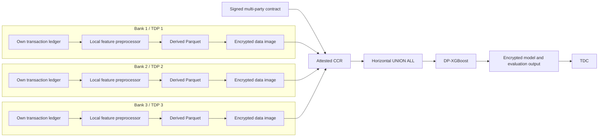

# Mule Account Detection: Technical Writeup

## Executive summary

This change adds a complete DEPA Training scenario in which three banks
collaborate on a mule-account risk model without pooling raw transaction
ledgers in an ordinary shared database.

Each bank runs the same preprocessor locally. It converts transactions into an
account-level table containing seven behavioural features and a binary training
label. Raw transactions, counterparty identifiers, and the local account
identifier are not written to the provider output. The three provider tables
are encrypted separately, mounted inside an attested Confidential Clean Room
(CCR), combined row-wise with `UNION ALL`, and used to train a differentially
private XGBoost classifier.

The implementation is a reference architecture and integration demonstration.
It is not a production fraud model and its PaySim-derived labels are proxies,
not confirmed mule-account outcomes.

## The five-minute explanation

The business problem is that a single bank sees only its own customers and
transactions, while mule behaviour can benefit from a model trained on a
broader population. Directly centralising every bank's raw ledger creates
privacy, governance, and trust problems.

DEPA Training separates the responsibilities:

1. Each Training Data Provider (TDP), here a bank, prepares its own approved
   training table.
2. The banks and the Training Data Consumer (TDC) agree to a machine-readable
   contract describing the participants, datasets, purpose, privacy limits,
   and compute provider.
3. Each provider encrypts its table. The tables are made available only to an
   attested CCR operated by the CCR Provider (CCRP).
4. The CCR combines the three identically shaped tables and trains the model.
5. Differential privacy is applied during XGBoost training, and the resulting
   model and evaluation artifacts are written to an encrypted output volume.

The sample uses the public PaySim simulator so anyone can exercise the
architecture without real bank data. It deterministically assigns PaySim
accounts to three sample banks. In a real consortium, each bank would instead
read only its own ledger and use historically confirmed investigation outcomes
for labels.

## DEPA vocabulary

| Term | Meaning in this scenario |
|---|---|
| DEPA Training | A techno-legal pattern for governed, privacy-preserving collaborative model training. |
| TDP | Training Data Provider. `bank_1`, `bank_2`, and `bank_3` each provide one derived training table. |
| TDC | Training Data Consumer. The consortium member authorised to receive and use the trained model. |
| CCR | Confidential Clean Room. The attested confidential compute environment in which datasets are joined and training runs. |
| CCRP | CCR Provider. The party operating the confidential environment and identified in the contract. |
| Contract service | The service that records the signed agreement and returns the contract sequence used by deployment. |
| DID | Decentralized Identifier. This scenario requires organization-controlled `did:web` identities for the three banks, TDC, and CCRP. |
| Differential privacy | A mathematical privacy mechanism applied here by DP-XGBoost during model training. |
| Attestation | Evidence that the expected confidential-container policy is running before protected keys are released. |

The contract, encryption, attestation, and differential privacy controls solve
different problems. A contract expresses authorization and purpose. Encryption
protects stored and transported files. Attestation controls where keys can be
released. Differential privacy limits what the trained model can reveal about
individual training records. None of these controls replaces the others.

## Architecture and data flow



The checked-in PaySim demonstration changes the three `Own transaction ledger`
boxes into three views of one public fixture. The account-to-bank rule is
deterministic (`numeric account id modulo 3`), which gives the sample three
disjoint account populations without coordination. This is fixture generation,
not a claim that one production bank can read another bank's records.

### Data at each boundary

| Stage | Data present |
|---|---|
| Bank-local input | PaySim rows in the demo; the bank's own transaction and case history in production. |
| Bank-local working data | Account IDs, counterparty IDs, raw amounts and times, intermediate rolling windows, and proxy labels. |
| Provider Parquet | Seven numerical behavioural features plus `is_mule`. |
| Explicitly removed | `account_id`, raw transaction rows, and counterparty identifiers. |
| CCR working data | Three decrypted provider feature tables, the joined training table, model state, and test predictions. |
| CCR output | XGBoost model and configured aggregate evaluation artifacts in an encrypted filesystem. |

Removing `account_id` is data minimization, not anonymization proof. The derived
features and labels can still be sensitive. They remain governed by the
contract and encrypted outside the attested compute environment.

## Feature engineering and labels

The shared implementation is
[`src/mule_features.py`](./src/mule_features.py). Each output row represents one
account assigned to the current provider.

| Column | Meaning | PaySim derivation |
|---|---|---|
| `account_age_days` | Approximate account age | Time from the account's first observed event to the end of the simulation. |
| `vel_24` | Peak one-day transaction velocity | Maximum trailing 24-hour inbound-plus-outbound value. |
| `vel_48` | Peak two-day transaction velocity | Maximum trailing 48-hour inbound-plus-outbound value. |
| `vel_72` | Peak three-day transaction velocity | Maximum trailing 72-hour inbound-plus-outbound value. |
| `fan_in` | Breadth of incoming counterparties | Distinct senders over the observation period. |
| `fan_out` | Breadth of outgoing counterparties | Distinct receivers over the observation period. |
| `dormancy_ratio` | Inactivity followed by activity proxy | Longest inactive gap divided by the observed active span. |
| `is_mule` | Binary training-label proxy | Destination of a fraudulent transfer or origin of a fraudulent cash-out. |

The code keeps every positive proxy row and caps the negative sample per bank at
50,000 by default so a local demonstration remains tractable. It fills invalid
feature values deterministically and uses seed `42` for repeatable negative
sampling.

PaySim does not provide true account-opening dates, six-month observation
windows, or confirmed investigation decisions. Therefore `account_age_days`,
`dormancy_ratio`, and `is_mule` are demonstration proxies. A production adapter
must define an observation cutoff, avoid future-data leakage, and derive labels
from confirmed historical cases.

## Why the join is horizontal

All three providers produce the same columns for different accounts. The
correct operation is therefore a horizontal, row-wise union:

```text
bank_1 rows
UNION ALL bank_2 rows
UNION ALL bank_3 rows
```

It is not a vertical join. A vertical join would attach different columns for
the same entity and would require a shared join identifier. This scenario does
not send an account identifier to the CCR.

An important framework fix accompanies the scenario. `SparkJoin` historically
called `dropDuplicates()` after every query. Two different accounts can have
identical feature values, so that behaviour could silently discard legitimate
rows after `UNION ALL`. The new optional
`joined_dataset.deduplicate_rows` setting controls this step:

- The default is `true`, preserving existing scenarios' behaviour.
- Mule detection sets it to `false`, preserving every provider row.
- A non-boolean value is rejected instead of being interpreted ambiguously.

This preserves row multiplicity without weakening the privacy boundary by
adding `account_id` to the provider table.

## Model training and evaluation

The pipeline runs `Train_XGB` with these checked-in values:

| Setting | Value |
|---|---:|
| Objective | `binary:logistic` |
| Differential privacy | Enabled |
| Epsilon | `5.0` |
| Delta | `0.00001` |
| Trees | `20` |
| Maximum depth | `3` |
| Learning rate | `0.3` |
| Subsample | `0.5` |
| Feature scaling | Min-max |
| Split | Stratified 80% train, 10% validation, 10% test |
| Random seed | `42` |

These values are demonstration defaults, not a statement that the privacy or
utility tradeoff is appropriate for a particular consortium. The participants
must choose and approve the privacy budget and model configuration for a real
deployment.

The shared XGBoost evaluator also needed a correctness fix. Previously,
probability predictions were converted to `0` or `1` before all metrics ran.
That is acceptable for accuracy, precision, recall, and F1, but it destroys the
ranking information required by ROC-AUC and precision-recall curves.

The trainer now sends raw probability scores to `compute_metrics`. The evaluator
applies a `0.5` threshold only for label-based metrics and retains continuous
scores for ranking metrics. The same behaviour is used for the DP model and the
non-DP comparison model.

### Differential-privacy boundary

The DP mechanism is applied by DP-XGBoost during training. It is not applied by
the provider preprocessors or Spark union. The configured evaluation reports
and plots are computed inside the CCR, but this scenario does not add a separate
DP release mechanism to those aggregates. Production governance must therefore
review which evaluation artifacts are allowed to leave the CCR, especially for
small or imbalanced test sets.

## Contract, identities, and trust

The contract template records:

- Three TDP DIDs, one per bank.
- One TDC DID.
- One CCRP DID.
- The three dataset IDs and each dataset's official provider DID.
- Encrypted Azure Blob locations and Key Vault key identifiers.
- Purpose `TRAINING`.
- Per-dataset epsilon and delta constraints.
- Start and expiry times.

[`contract/prepare-contract.sh`](./contract/prepare-contract.sh) renders an
infrastructure-specific unsigned contract. It requires all five identities to
be non-empty `did:web` values, requires the bank DIDs to be distinct, maps each
dataset to the corresponding bank, generates a new contract ID and validity
window, and rejects unresolved placeholders.

The intended signing sequence is Bank 1, Bank 2, Bank 3, and then the TDC, with
each organization using its own DID document and private signing key. The CCRP
is identified as the compute provider. The final contract sequence is supplied
to the deployment.

The renderer does not create identities, hold private signing keys, sign for an
organization, or register the contract. Those steps require the consortium's
official contract-service endpoint and organization-controlled credentials.
The four-party flow is documented for integration, but it was not executed in
the credential-free validation of this pull request.

The Azure scripts now require an explicit non-loopback HTTPS contract-service
URL. They reject HTTP, localhost, loopback IPs, wildcard addresses, and Docker's
host alias. This prevents a deployment from silently binding key-release policy
or contract retrieval to a developer-local service.

## Encryption, attestation, and Azure deployment

The cloud path follows the same lifecycle as the repository's other Azure CCR
scenarios:

1. Create provider and output storage containers.
2. Create Azure Key Vault resources.
3. Obtain contract-service parameters, generate the confidential-container
   policy, and import encryption keys with the expected attestation policy.
4. Put each provider Parquet table in its own encrypted filesystem image and
   upload it. Create a separate writable encrypted output image.
5. Render, sign, and register the contract.
6. Consolidate the pipeline configuration and deploy confidential Azure
   Container Instances with the registered contract sequence.
7. After successful completion, download and decrypt the output image.

Attestation-bound key release is important: possession of an encrypted image or
its storage URL should not by itself provide access to the plaintext. The key
release policy must match the confidential workload. If the image, command,
environment, sidecar parameters, or policy changes, the policy and imported
keys may need to be regenerated.

## Repository changes

### Scenario implementation

The scenario adds:

- Shared feature engineering and three bank-specific entry points.
- Three preprocessor Dockerfiles and image helper scripts.
- Local Docker Compose preprocessing and training flows.
- Dataset, join, model, evaluation, training, and consolidated pipeline configs.
- Contract template and renderer.
- Azure storage, Key Vault, encryption, upload, deployment, download, and
  decryption scripts and templates.
- Confidential-container policy template.
- Build-your-own-scenario example.
- Root scenario index entry and scenario documentation.
- Feature, privacy-boundary, contract, deployment, configuration, and framework
  regression tests.

### Hardening and shared framework fixes

The final review added:

- `deduplicate_rows` with a backward-compatible default in `SparkJoin`.
- Raw-score evaluation for both DP and non-DP XGBoost models.
- Complete participant/provider DID rendering and validation.
- Strict remote HTTPS contract-service validation shared by key import and
  deployment.
- A non-conflicting `mule-detection-1` generator output name.
- Pinned unit-test dependencies and pull-request CI coverage.
- Expanded ignored credential, key, signed-contract, and generated artifact
  patterns.
- Explicit documentation of privacy semantics, signing responsibilities,
  credentialed-test deferrals, and production limitations.

## Important files

| File | Responsibility |
|---|---|
| [`src/mule_features.py`](./src/mule_features.py) | Bank-local feature and proxy-label derivation; removes `account_id` from provider output. |
| [`config/join_config.json`](./config/join_config.json) | Three-provider `UNION ALL` and multiplicity policy. |
| [`config/train_config.json`](./config/train_config.json) | DP-XGBoost, data split, preprocessing, and metric settings. |
| [`config/pipeline_config.json`](./config/pipeline_config.json) | Consolidated CCR task sequence. |
| [`contract/contract.json`](./contract/contract.json) | Machine-readable contract template. |
| [`contract/prepare-contract.sh`](./contract/prepare-contract.sh) | Validates participants and renders the unsigned contract. |
| [`deployment/local/`](./deployment/local/) | Local demonstration orchestration. |
| [`deployment/azure/`](./deployment/azure/) | Azure CCR lifecycle and URL trust checks. |
| [`tests/`](./tests/) | Scenario-level regression tests. |
| [`../../src/train/pytrain/join.py`](../../src/train/pytrain/join.py) | Shared Spark join behaviour. |
| [`../../src/train/pytrain/xgb_train.py`](../../src/train/pytrain/xgb_train.py) | Shared XGBoost training and evaluation. |

## Validation evidence

The credential-free PR checks cover:

- Feature calculations, deterministic bank partitions, labels, negative
  sampling, and provider schema.
- The Parquet privacy boundary: the written file has the expected provider
  columns and no `account_id`.
- Contract rendering, required fields, `did:web` validation, distinct bank
  identities, and dataset-provider mapping.
- Rejection of insecure or loopback contract-service endpoints.
- Mule configuration consistency and the non-conflicting generator example.
- Spark union row preservation, legacy deduplication, and invalid config types.
- Raw probability propagation, label thresholding, ROC-AUC behaviour, and
  precision-recall thresholds.
- JSON parsing, shell syntax, Python compilation, Docker Compose parsing,
  generator smoke, generated-config consistency, dataset-ID consistency,
  secret scanning, and Git whitespace checks.

The scenario tests require no network. The shared Spark/XGBoost regression tests
run in the core image in pull-request CI because that image contains the full
training stack.

The following were not validated without external infrastructure and must not
be presented as completed tests:

- Building the core and scenario Docker images when the local Docker daemon is
  unavailable.
- Downloading and preprocessing the full PaySim dataset with Kaggle credentials.
- Provisioning Azure resources and running a confidential ACI workload.
- Four-organization signing and registration against a consortium contract
  service.
- Attested key release and end-to-end encrypted model retrieval.

## Security and privacy claims: say exactly this

Safe claims:

- The provider output excludes raw transaction rows, counterparty identifiers,
  and `account_id`.
- Provider tables are designed to be encrypted before cloud upload and decrypted
  only in the attested CCR.
- DP-XGBoost applies differential privacy during training with the configured
  epsilon and delta.
- Participant authorization and permitted computation are represented in a
  multi-party contract.
- Tests verify the code-level privacy boundary and configuration invariants.

Claims this sample does **not** establish:

- That the feature table is anonymous or harmless if disclosed.
- That epsilon `5.0` is the correct production budget.
- That evaluation artifacts receive a separate DP guarantee.
- That PaySim performance predicts real-world mule detection.
- That the scenario is a production AML decisioning or case-management system.
- That the credentialed Azure and signing flow has already passed end to end.

## Suggested technical showcase

A focused review can fit in 12 to 15 minutes:

1. **Problem and roles (2 minutes):** explain why three banks want a shared
   model and identify TDP, TDC, CCRP, CCR, and contract service.
2. **Data boundary (3 minutes):** open `mule_features.py`, show the seven
   features and `to_provider_features`, then emphasize that PaySim is only a
   synthetic fixture.
3. **CCR pipeline (3 minutes):** open `join_config.json` and
   `train_config.json`; explain horizontal `UNION ALL`, `deduplicate_rows:
   false`, and DP-XGBoost.
4. **Trust flow (3 minutes):** open the contract template and renderer; explain
   participant DIDs, dataset-provider mapping, signed authorization,
   encryption, attestation, and key release.
5. **Correctness and readiness (2 minutes):** show the scenario and shared
   regression tests, the CI jobs, and the explicit list of deferred
   credentialed checks.

For a credential-free live demonstration, run:

```bash
python -m unittest discover -s scenarios/mule-detection/tests -v
find scenarios/mule-detection -name '*.json' -print0 | xargs -0 -n1 jq empty
find scenarios/mule-detection -name '*.sh' -print0 | xargs -0 -n1 bash -n
```

Do not attempt the Kaggle, contract-signing, or Azure portions during the review
unless credentials, organization identities, infrastructure, time, and cleanup
ownership have been arranged in advance.

## Reviewer questions and concise answers

### Why is DEPA needed if the output has no account ID?

Removing one direct identifier is useful data minimization, but behavioural
features and labels can still be sensitive. DEPA adds governed purpose,
participant agreement, encrypted transport/storage, attested computation, and
privacy-preserving training rather than treating column removal as sufficient.

### Why do all three sample banks download the same PaySim file?

It keeps the public demo reproducible. The modulo rule gives each sample bank a
disjoint account partition. A production bank adapter would read only that
bank's systems; the sample is not modelling shared access to real ledgers.

### Why `UNION ALL` instead of a join on account ID?

The banks hold different accounts but produce the same columns. The training
population is the rows from all three banks, so a horizontal union is correct.
No cross-provider entity linkage is needed.

### Why disable duplicate removal?

Two distinct accounts can legitimately have the same seven feature values and
label. Deduplicating those rows changes the population and class distribution.
The new flag preserves them without sending account IDs. Existing scenarios
still deduplicate because the default remains `true`.

### Where is differential privacy applied?

Inside `Train_XGB` during model fitting, not in local feature engineering or
Spark. The configured budget is epsilon `5.0`, delta `0.00001`. That is a demo
choice that a real consortium must review.

### Why was the XGBoost evaluator changed?

ROC-AUC and precision-recall require ranked scores. Thresholding probabilities
before evaluation reduced them to hard labels and made those metrics
misleading. Raw scores now reach the evaluator; discrete metrics still use a
`0.5` threshold.

### Does the trained model identify real mule accounts?

No such claim is made. PaySim is synthetic and `is_mule` is a proxy based on
fraudulent transfer destinations and cash-out origins. The scenario proves the
collaborative training path, not production detection performance.

### Who signs the contract?

The intended sequence has the three bank TDPs and the TDC sign with their own
organization-controlled `did:web` keys. The CCRP is identified in the
contract. The renderer prepares an unsigned instance; it cannot sign on behalf
of any organization.

### What prevents someone from substituting a local contract service?

The key-import and deployment scripts share a validator that requires an
explicit remote HTTPS URL and rejects localhost, loopback addresses, wildcard
addresses, and Docker's host alias. Production TLS and service governance still
remain operational responsibilities.

### What is tested and what remains?

Pure feature, configuration, contract, deployment guard, Spark, and evaluator
logic has automated coverage. JSON, shell, Compose, generator, consistency,
secret, and whitespace checks are also available. Full Docker builds, Kaggle,
Azure confidential deployment, multi-party registration, and attested key
release require their respective external systems and are explicitly deferred
until those systems are available.

### What would be required before production use?

At minimum: bank-specific adapters and data definitions, confirmed labels,
temporal leakage analysis, privacy-budget approval, threat modelling, artifact
release policy, model validation and fairness review, monitoring, drift and
retraining governance, key/DID lifecycle operations, incident response,
regulatory approval, and integration with human AML investigation workflows.

## Current limitations and next steps

1. Replace PaySim proxies with consortium-approved production definitions and
   confirmed outcomes.
2. Use explicit observation and label windows and test for temporal leakage.
3. Tune and approve the DP budget and model using an agreed privacy/utility
   process.
4. Decide whether and how evaluation artifacts may leave the CCR.
5. Exercise the documented signing sequence with real organization DIDs and the
   selected contract service.
6. Run the full encrypted Azure lifecycle and retain non-secret validation
   evidence.
7. Add production model validation, monitoring, explainability, case-management
   integration, and operational governance.

The correct success statement for this pull request is: **the repository now
contains a tested, documented mule-account collaborative-training reference
scenario and the shared framework fixes it requires; production data science
and credentialed consortium deployment remain deliberate follow-on work.**
